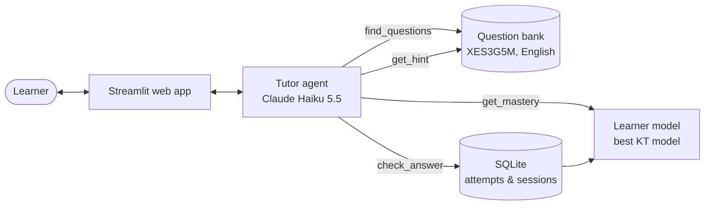

# WIH3001 LLM Tutor

**Agentic AI for Personalized Adaptive Learning: A Knowledge-Tracing-Guided LLM Tutor for Primary School Mathematics**

A web-based maths tutor that knows what each learner has mastered and uses that to decide what to practise next. It has two parts that work together:

- a **learner model** (knowledge tracing) that estimates, from a learner's past answers, how well they know each of 865 maths concepts; and
- a **tutor agent** (an LLM with tools) that reads those estimates to pick the next question, gives step-by-step hints taken from verified worked solutions, explains *why* it chose each question, and never hands over the final answer before the learner has tried.

This is the final-year project for WIH3001 (Data Science Project), Faculty of Computer Science and Information Technology, Universiti Malaya.

| | |
|---|---|
| **Author** | Tan Wei Ren |
| **Supervisor** | Dr. Kasturi Dewi Varathan |
| **Status** | Planning: requirements and design documents written; implementation not started |

## How it works



The agent works in a five-step loop (diagnose, plan, teach, assess, reflect). It targets the weakest concept that comes early in the concept tree, and picks a question the learner is predicted to answer correctly about 60 to 85% of the time.

| Tool | Purpose |
|---|---|
| `get_mastery(student_id)` | Mastery estimate for each concept |
| `find_questions(concept, difficulty)` | Search the question bank |
| `get_hint(question_id, level)` | Next step of the worked solution; at a higher level, the concept and a worked solution to a related question |
| `check_answer(question_id, answer)` | Mark the answer and update the learner's record |

## Data

The project uses [XES3G5M](https://github.com/ai4ed/XES3G5M) (Liu et al., NeurIPS 2023; MIT license): about 5.5 million answers from 18,066 students on 7,652 Grade 3 maths questions, with question text, worked solutions and an 865-concept tree. The English translation comes from [KCQRL](https://github.com/oezyurty/KCQRL) (Ozyurt et al., 2024).

**The data is not stored in this repository.** Download it yourself and place it under `data/raw/` (the folder is git-ignored).

## Learner models compared

Logistic regression (baseline), BKT, DKT, SAKT and AKT, trained with [pyKT](https://github.com/pykt-team/pykt-toolkit) on the dataset's five folds and scored on its held-out test set with AUC (main), accuracy and RMSE.

## Repository layout (planned)

```
WIH3001_LLM_Tutor/
├── docs/               PRD, TRD, Design spec and UI/UX survey
├── notebooks/          EDA and model experiments (Colab)
├── src/tutor/
│   ├── data/           loading, cleaning, question bank build
│   ├── kt/             knowledge tracing training and inference
│   ├── agent/          tools, policy, prompts, agent loop, guardrails
│   ├── app/            Streamlit pages and components
│   ├── db/             SQLite schema and access
│   └── eval/           simulated students, baselines, metrics
├── tests/
├── data/               (git-ignored) raw and processed data
└── models/             (git-ignored) trained checkpoints
```

## Getting started (planned)

```bash
git clone https://github.com/wiiiren/WIH3001_LLM_Tutor.git
cd WIH3001_LLM_Tutor
python -m venv .venv && .venv\Scripts\activate   # Windows
pip install -r requirements.txt
# put your Anthropic API key in .streamlit/secrets.toml (git-ignored)
streamlit run src/tutor/app/main.py
```

## Documents

| Document | What it covers |
|---|---|
| [UI/UX Survey](docs/UX_Survey.md) | Research on hints, learner dashboards, explanations, teacher views and child-friendly design, and what each finding means for this app |
| [PRD](docs/PRD.md) | Product requirements: users, goals, features, acceptance criteria, success metrics |
| [TRD](docs/TRD.md) | Technical requirements: architecture, data, models, agent, guardrails, storage, deployment, testing |
| [Design](docs/Design.md) | UI/UX design spec: flows, screens, hint ladder, copy, visual system, accessibility |

## Scope limits

Text-only questions (image-based questions are excluded), machine-translated English, and usability testing with adult volunteers only. Testing with children and measuring real learning gains are out of scope.

## License

To be decided. The XES3G5M dataset is MIT-licensed; check its terms before redistributing any derived files.
