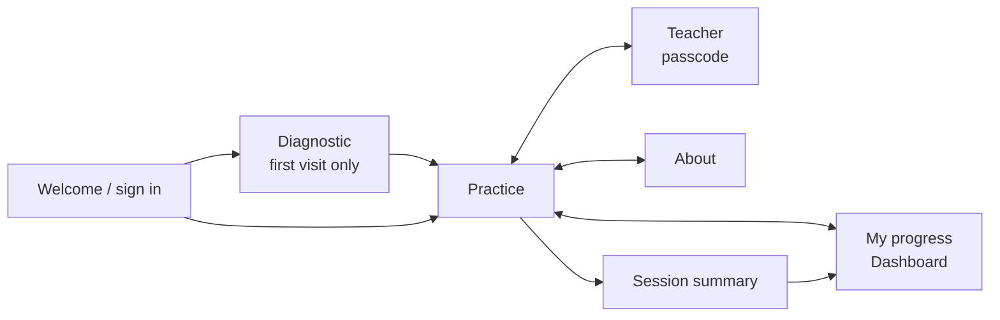
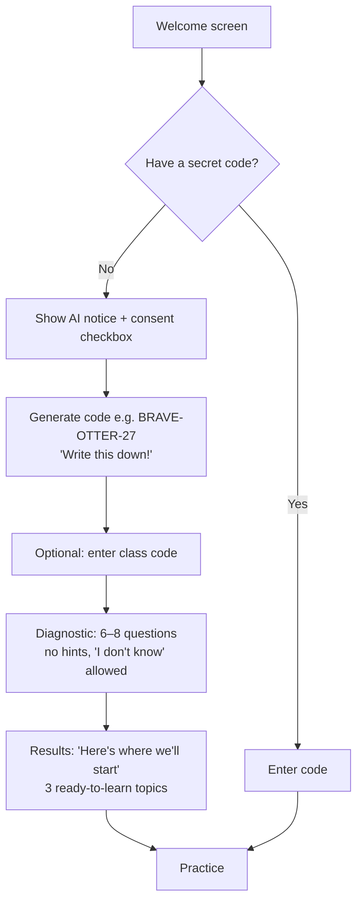
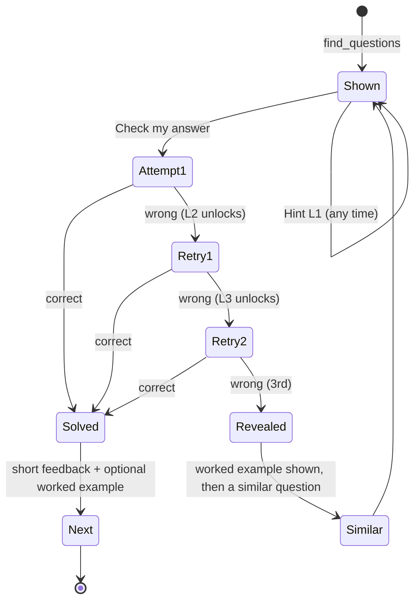

# Design Specification

**Project:** WIH3001: Knowledge-Tracing-Guided LLM Tutor for Primary School Mathematics
**Author:** Tan Wei Ren
**Version:** 0.1 (draft) · **Date:** 27 November 2026
**Related:** [UI/UX Survey](UX_Survey.md) (evidence and decisions D1–D16) · [PRD](PRD.md) · [TRD](TRD.md)

This spec turns the survey's decisions into screens, flows, words and visual rules. It extends the rough layout in proposal Figure 3.

---

## 1. Design principles

1. **The question comes first.** Answering is the main action on every practice screen; the chat supports it (D4).
2. **Help makes you think.** Hints come in steps, unlock with effort, and end with something to do (D1, D2, D5).
3. **Show your reasons.** Every recommendation says why, in one sentence a 9-year-old can read (D11).
4. **Calm, not noisy.** No confetti, streak pressure, pop-ups or slogans. Feedback is short and specific (D7, D12).
5. **Fast feedback.** Marking is instant. Tutor text streams, and the app says what it is doing while it waits (D14).
6. **Readable for children, checkable for adults.** Words and bands first; numbers available for those who want them (D8, D15).

## 2. Information architecture

Top navigation (Streamlit `st.navigation`, position `top`), the same four tabs as Figure 3:



| Tab label | Page | Who |
|---|---|---|
| **Practice** | Question, tutor, hints, why panel | Learner |
| **My progress** | Mastery by concept, ready-to-learn | Learner |
| **Teacher** | Class grid, flags, who to see next | Teacher (passcode) |
| **About** | What the tutor is, AI notice, data use, model in use | Everyone |

"Dashboard" in Figure 3 is labelled **My progress** in the UI because it is clearer for children. Figure 3 can keep "Dashboard" as the technical name.

## 3. Key flows

### 3.1 First visit



### 3.2 Question lifecycle



- After **Solved**, the learner may tap "See the full solution" (optional).
- After **Revealed**, the worked example is shown automatically, labelled **Worked example**. Then the tutor offers a similar question on the same concept (D1; Shih et al., 2008).
- **Skip** (open question in PRD §11): available after one attempt; counts as wrong.

## 4. Screens

Wireframes are at desktop width (≥ 1024 px). §10 covers narrow screens.

### 4.1 Welcome / sign in

```
┌──────────────────────────────────────────────────────────────┐
│  AI Maths Tutor                                              │
├──────────────────────────────────────────────────────────────┤
│                                                              │
│   Practise maths with a tutor that learns what you know.     │
│                                                              │
│   [  I'm new, let's start  ]     [  I have a secret code  ]  │
│                                                              │
│   ⓘ Your tutor is an AI. It can make mistakes. Its hints     │
│     come from checked solutions. We don't ask for your name. │
│     More in About.                                           │
└──────────────────────────────────────────────────────────────┘
```

- The secret code is shown large, in monospace, with a "Copy" button and "Write this down so you can come back."
- Consent (volunteers): one checkbox, "I agree to take part and know my answers are saved without my name." The Start button is disabled until it is ticked.
- Teacher entry is a small link at the bottom: "Teacher? Go to Teacher tab".

### 4.2 Diagnostic

- Same question card as Practice, but the hint ladder and why panel are hidden. A header says: "Warm-up: 6 quick questions so I can find the right level. It's fine not to know!"
- There is an extra button: **I don't know** (recorded as wrong; no penalty message).
- No right/wrong feedback per question, which keeps it low-pressure. A progress dot row is shown (●●●○○○).
- End screen: "Here's where we'll start" with the 3 ready-to-learn topics and a **Start practising** button.

### 4.3 Practice (proposal Figure 3a)

```
┌───────────────────────────────────────────────────────────────────────────┐
│  AI Maths Tutor        [Practice] [My progress] [Teacher] [About]         │
├───────────────────────────────────────────────────┬───────────────────────┤
│  Question 3 of 10   ●●●○○○○○○○                     │  Why this question?   │
│ ┌───────────────────────────────────────────────┐ │                       │
│ │ Speed problems                                 │ │  Topic                │
│ │ A car travels 120 km in 2 hours.               │ │  Speed problems       │
│ │ What is its speed in km/h?                     │ │                       │
│ │                                                │ │  Your level           │
│ │ ┌──────────────────────┐ [ Check my answer ]   │ │  ▓▓▓▓░░░░░░ Not yet   │
│ │ │ Type your answer…    │                       │ │                       │
│ │ └──────────────────────┘                       │ │  Chance you'll get it │
│ │ Attempt 1 · ✗ Not quite. Check the time part.  │ │  about 7 in 10        │
│ └───────────────────────────────────────────────┘ │                       │
│                                                   │  Why                  │
│  Need help?                                       │  This is your weakest │
│  [💡 Hint 1: A nudge ] [🪜 Hint 2: Next step ]     │  topic that comes     │
│  [📘 Hint 3: Similar example 🔒 after 2 tries ]    │  early, so it helps   │
│                                                   │  with later topics.   │
│  ┌ Tutor ──────────────────────────────────────┐  │                       │
│  │ Speed tells us how far you go in 1 hour.     │  │  [Show numbers]       │
│  │ How many hours did the car drive?            │  │  mastery 0.41 · p 0.72│
│  └──────────────────────────────────────────────┘  │                       │
│  ┌ You ─────────────────┐                          │  [Practise something  │
│  │ i dont get it        │                          │   else]               │
│  └──────────────────────┘                          │                       │
│  [ Ask the tutor…                         ] [Send] │                       │
│  [Explain it another way]   ⚑ Report a problem     │                       │
└───────────────────────────────────────────────────┴───────────────────────┘
```

**Layout:** two columns at about 68% / 32%. The left column holds the question card, hint ladder and chat thread. The right column holds the **Why this question?** panel.

**Question card**
- Topic name as a small label above the question; question text at 20 px.
- Multiple-choice questions show option buttons (A–D), one per line, at least 44 px tall. Tapping one selects it, then **Check my answer** confirms.
- Fill-in questions show a text box. Pressing Enter does the same as the button.
- The attempt result shows on a line *inside the card*, instantly (from `check_answer`), before any tutor text. The line has an icon and text, never colour alone:
  - ✓ **Correct!**
  - ✗ **Not quite.** (followed by a short specific clause from the tutor when it arrives)

**Hint ladder (D1, D2)**
- Three buttons in a row, with the states in §5.
- A revealed hint appears in the tutor thread with a 💡 label ("Hint 2: Next step") and stays there.

**Tutor thread**
- `st.chat_message` bubbles: tutor on the left with a neutral avatar, learner on the right.
- Only the current question's thread is shown. Earlier questions collapse to one line ("Q2 · Fractions · ✓ on 2nd try").
- While the agent works, a status line shows above the input with a small spinner (D14):
  - "Checking your progress…" for `get_mastery`
  - "Finding a good question…" for `find_questions`
  - "Getting a hint…" for `get_hint`
  - "Checking…" for `check_answer`
- **Ask the tutor** is an inline chat input inside the left column (not pinned to the page bottom), so it stays near the question.
- If the learner types a guess ("is it 60?"), the tutor replies "Pop it in the answer box and I'll check!" and the answer box gets focus.

**Why this question? panel (D11)**
- Fields: Topic · Your level (bar + band word) · Chance you'll get it ("about 7 in 10", which is easier for children than "72%") · Why (one sentence from the reason code, §7.3).
- **Show numbers** toggles exact values (mastery 0.41, P(correct) 0.72). It is off by default for learners and on by default when `?debug=1`.
- **Practise something else** opens the 3 ready-to-learn topics (same as the dashboard D9).
- On screens narrower than 900 px, the panel collapses into an expander under the question titled "Why this question?".

**Explain it another way (D6)**
- Before L3 is unlocked, the tutor re-words the L1 idea differently. After L3 is unlocked, it uses the related worked example. It is shown as a text button under the chat input.

**End of session (F15)**
- After 10 questions, a summary card shows:
  - topics practised, with band before → after (e.g., "Speed problems: Not yet → Getting there"),
  - the number solved without hints, and
  - buttons for **Keep going** and **See my progress**.

### 4.4 My progress (proposal Figure 3b, left)

```
┌───────────────────────────────────────────────────────────────────────┐
│  My progress                                                          │
│                                                                       │
│  Ready to learn next                                                  │
│  ┌───────────────┐ ┌───────────────┐ ┌───────────────┐                │
│  │ Speed problems│ │ Fractions of  │ │ Area of       │                │
│  │ Not yet       │ │ a number      │ │ rectangles    │                │
│  │ [Practise this]│ │ [Practise this]│ │ [Practise this]│             │
│  └───────────────┘ └───────────────┘ └───────────────┘                │
│                                                                       │
│  All topics          ✓ Mastered 12   ◐ Getting there 9   ○ Not yet 7  │
│  ▸ Calculation (14 topics)        ▓▓▓▓▓▓▓░░░                          │
│  ▾ Applications (9 topics)        ▓▓▓▓░░░░░░                          │
│      Speed problems    ○ Not yet        ▓▓▓▓░░░░░░                    │
│      Work problems     ◐ Getting there  ▓▓▓▓▓▓▓░░░                    │
│      Age problems      ┆ Not enough answers yet ┆ (dashed)            │
│  ▸ Geometry (6 topics)            ▓▓▓▓▓▓▓▓░░                          │
│  ▸ Counting & logic (8 topics)    ▓▓▓▓▓▓░░░░                          │
└───────────────────────────────────────────────────────────────────────┘
```

- **Ready to learn next (D9):** the top 3 policy candidates. Each card shows the topic, its band and a **Practise this** button. Choosing one records `LEARNER_CHOICE`.
- **Summary chips:** counts per band, each with an icon (✓ ◐ ○), covering topics the learner has *met*. Unmet topics are not counted, so a new learner doesn't see "0 of 865".
- **Topic groups:** grouped by the top level of the concept tree and collapsed by default. A group's bar shows the average mastery of its met topics.
- **Concept rows:** the topic name in plain English, a band icon and word, and a bar. The exact value shows on hover or focus (D8).
- **Uncertain** concepts (fewer than 3 answers) show a dashed outline bar and "Not enough answers yet" (D10).
- **Empty state:** before any practice, show "Do the warm-up to see your progress here." with a **Start warm-up** button.
- **Visible topics:** only topics the learner has met, plus the ready-to-learn ones, are listed. A link **Show all topics** expands to the full tree for examiners.

### 4.5 Teacher overview (proposal Figure 3b, right)

```
┌──────────────────────────────────────────────────────────────────────────┐
│  Teacher · Class 3 Bestari (code MATH-3B)        [Sort: weakest ▾] [⤓ CSV]│
│                                                                          │
│  Who to see next                                                         │
│   1. BRAVE-OTTER-27 · Stuck on Speed problems · last seen 2 min ago  [Open]│
│   2. CALM-TIGER-04 · Hints before trying (6 of 10)                   [Open]│
│   3. KIND-PANDA-11 · Inactive 6 days                                 [Open]│
│                                                                          │
│  Class grid           Calc.   Applic.  Geometry  Counting   Flags        │
│  BRAVE-OTTER-27        ◐        ○         ◐         ◐       Stuck        │
│  CALM-TIGER-04         ✓        ◐         ○         ◐       Hints early  │
│  KIND-PANDA-11         ◐        ◐         ◐         ○       Inactive     │
│  ...                                                                     │
└──────────────────────────────────────────────────────────────────────────┘
```

- **Access:** the teacher passcode (or the study master passcode) is entered once per browser session.
- **Who to see next (D13):** up to 5 flagged students. They are ordered by flag severity, then by the oldest *teacher last viewed* time, which counters "sticky help". Opening a student updates `teacher_views`.
- **Class grid (D12):** rows are students; columns are top-level concept groups. Cells show the band icon and a light band colour, and the band word on hover. Grid cells use icons rather than words to save space.
- **Flags:** shown as small text tags (Stuck, Hints early, Inactive). They are not red alerts. There are no pop-ups or sounds.
- **Student detail (Open):** the weakest 5 concepts with bars, the last 10 attempts (question, ✓/✗, hints used, time), and the hint-before-attempt rate.
- **Demo mode:** for the SUS study, a seeded demo class (`is_demo = 1`) is used so the volunteer can do the timed task (Survey Q5).

### 4.6 About

Sections, each in 2–4 short sentences:
1. **What is this?** — A maths practice tutor for Grade 3 topics, made as a university project.
2. **Is the tutor a person?** — "No. It's an AI. It can make mistakes. If something looks wrong, tap ⚑ Report a problem."
3. **Where do hints come from?** — "From the checked worked solution for each question. The tutor rewords them."
4. **How does it choose questions?** — The learner model and the 60–85% rule, in plain words.
5. **What do we save?** — The secret code, answers and chat, with no names. Kept until the project is marked, then deleted.
6. **Behind the scenes** (for adults) — Which KT model is live (e.g., "AKT, test AUC 0.81"), the LLM name, and a link to the GitHub repo.

## 5. Hint ladder specification

| Level | Button label | Unlocks | Content (from `get_hint`) | Tutor wraps it as |
|---|---|---|---|---|
| L1 | 💡 Hint 1: A nudge | Any time | Concept name + guiding idea | A short reminder of the idea, then a question to act on |
| L2 | 🪜 Hint 2: Next step | After 1 attempt | Next unrevealed step of this question's worked solution (never the final step) | The step in simpler words, then "Try that part." |
| L3 | 📘 Hint 3: Similar example | After 2 attempts | Concept summary + full worked solution of a related question | Walk through the example, then "Now try yours the same way." |
| — | 📄 See the full solution | After solving, or automatically after 3 wrong | This question's full worked solution | Labelled **Worked example**; then a similar question if it wasn't solved |

**Button states**

| State | Look | Text |
|---|---|---|
| Available | Outline button | Label |
| Used | Outline, check icon | "Hint 1 ✓" (tap again to scroll to it) |
| Locked | Dimmed (still ≥ 4.5:1 text contrast), lock icon | "🔒 after 1 try" / "🔒 after 2 tries" |
| Hidden | — | During the diagnostic |

- Locked buttons stay visible, so learners can see that more help exists and how to unlock it (Survey Q1).
- Tapping a locked button shows the inline note "Have a go first! Hint 2 opens after you try once." It does not open a pop-up.
- L2 can be used more than once. Each use reveals the next step, stopping before the final step.
- All hint taps are logged with timing (D3).

## 6. System states

| State | Where | Behaviour |
|---|---|---|
| Loading (app start) | All | Full-page "Getting things ready…" with the app name; target < 60 s on cold start |
| Agent thinking | Practice | Status line (§4.3); controls stay usable except Check during marking |
| Marking | Practice | Check button shows "Checking…" for < 0.5 s |
| LLM slow (> 8 s) | Practice | "Still thinking…", then degraded mode |
| Degraded mode | Practice | Banner: "The tutor is resting. You can still practise and use hints." Hints show the raw step text; feedback uses templates |
| Answer blocked by guard | Practice | Message replaced with "Let's work it out together. What's the first step?" (logged) |
| No questions in band | Practice | Closest question is served; the why panel says "This one is a little harder (or easier) than usual." |
| Empty dashboard | My progress | Warm-up prompt (§4.4) |
| Wrong teacher passcode | Teacher | "That passcode didn't work." No data shown |
| Reported question | Practice | "Thanks! We'll check it." The next question is served |

## 7. Content and voice

### 7.1 Voice
- Friendly, calm, plain. Short sentences (≤ 12 words where possible). One idea per message.
- Use "you" and "we". Avoid jargon: say "topic", not "concept"; "level", not "mastery"; "chance you'll get it", not "probability".
- No generic praise ("Amazing!!", "You're a genius"), no mindset slogans, no exclamation chains (D7). At most one "Nice work." after a real effort.
- Every tutor message ends with something to do (D5).

### 7.2 Feedback templates (the LLM fills in the specific part)

| Situation | Template |
|---|---|
| Correct, 1st try | "✓ Correct! {one-line why it works}." |
| Correct after hints or retries | "✓ Correct! You fixed {specific thing}. Nice work." |
| Wrong, 1st try | "✗ Not quite. {point to the part to re-check}." |
| Wrong, 2nd try | "✗ Not yet. Hint 3 is open now if you want a similar example." |
| Wrong, 3rd try | "Let's look at how it's done. Here's a worked example." |
| Guess typed in chat | "Pop it in the answer box and I'll check!" |
| Off-topic | "I'm your maths tutor, so let's stick to maths. Ready for the next step?" |
| Asks for the answer | "I can't give the answer, but I can help you find it. {L1 idea}." |

### 7.3 Reason sentences (why panel)

| Reason code | Sentence |
|---|---|
| `WEAKEST_EARLY` | "This is your weakest topic that comes early, so it helps with later topics." |
| `PREREQ_FOR_NEXT` | "You'll need this for {next topic}, which is coming up." |
| `REVIEW_SLIPPING` | "You knew this before, but it's been a while. Quick check!" |
| `LEARNER_CHOICE` | "You picked this topic." |
| Difficulty note | "This one should be just right: hard enough to learn from." |

### 7.4 Words to use and avoid (D15)

| Use | Avoid |
|---|---|
| Check my answer | Submit |
| Secret code | Username, ID |
| Topic | Concept, KC |
| Your level | Mastery estimate |
| Chance you'll get it | Probability, P(correct) |
| Not yet / Getting there / Mastered | Weak / Failed / Low |

## 8. Visual system

### 8.1 Colour tokens

All text tokens meet WCAG AA (≥ 4.5:1) on both white and the page background. The ratios below were computed.

| Token | Hex | Use | Contrast vs #FFFFFF / #F7F8FA |
|---|---|---|---|
| `ink` | `#1F2937` | Body text | 14.7 / 13.8 |
| `ink-muted` | `#4B5563` | Labels, secondary text | 7.6 / 7.1 |
| `primary` | `#1D4ED8` | Main buttons, links, active tab | 6.7 / 6.3 |
| `band-notyet` | `#B45309` | "Not yet" icon, text and bar | 5.0 / 4.7 |
| `band-getting` | `#0E7490` | "Getting there" | 5.4 / 5.0 |
| `band-mastered` | `#15803D` | "Mastered" | 5.0 / 4.7 |
| `danger` | `#B91C1C` | Errors only (not for wrong answers) | 6.5 / 6.1 |
| `surface` | `#FFFFFF` | Cards | — |
| `page` | `#F7F8FA` | Page background | — |
| `hint-bg` | `#FEF3C7` | Hint bubble background (ink on it: 13.2) | — |
| `tutor-bg` | `#EEF2FF` | Tutor bubble background (ink on it: 13.1) | — |
| `bar-track` | `#E5E7EB` + 1 px `#6B7280` border | Empty part of bars (border keeps ≥ 3:1) | — |

- Wrong answers use **ink + ✗**, not red, to keep the tone calm.
- Bands use **icon + word + colour**. Amber and green can look alike to colour-blind users, so colour is never the only signal.

### 8.2 Typography
- **Font:** the system sans-serif stack (Streamlit default "sans serif").
- **Sizes:** body 18 px; question text 20 px; headings 24/20 px; small labels 14 px (adult-facing only).
- **Spacing:** line height 1.5; maximum line length about 70 characters in the question card.
- **Numbers:** tabular figures, so mastery values line up.

### 8.3 Spacing and shape
- An 8 px spacing grid. Cards: 16 px padding, 12 px radius, 1 px border `#D1D5DB`.
- Main buttons are at least 44 px tall and minimum targets 24 × 24 px (WCAG 2.5.8), with at least 8 px between hint buttons.

### 8.4 Components

| Component | Spec |
|---|---|
| Mastery bar | 160 × 12 px, rounded; fill = band colour; uncertain = dashed outline, no fill; value tooltip |
| Band chip | Icon + word, band-coloured text on white, 1 px band border |
| Question card | Surface card; topic label (14 px muted) → question (20 px) → answer row → result line |
| Hint button | Outline, 44 px tall, icon + label; states in §5 |
| Chat bubble | Tutor: `tutor-bg`, left; hint: `hint-bg` with 💡 label; learner: white with border, right |
| Status line | 16 px muted text + spinner, above the chat input |
| Why panel | Surface card, sticky in the right column; label/value pairs |

### 8.5 Icons
Emoji and Unicode icons (💡 🪜 📘 📄 ✓ ✗ ○ ◐ 🔒 ⚑) are used so no icon font is needed. Each icon has a text label beside it; icons are never the only content of a button.

## 9. Accessibility checklist (WCAG 2.2 AA)

- [ ] Text contrast ≥ 4.5:1 (tokens above); bar fills and borders ≥ 3:1 against neighbours.
- [ ] Targets ≥ 24 × 24 px; main buttons ≥ 44 px tall.
- [ ] Colour is never the only signal (icons + words on bands, results and flags).
- [ ] Full keyboard path: Tab order follows answer box → Check → hints → chat → why panel; Enter submits the answer.
- [ ] Focus is visible on all controls (Streamlit default kept, not removed by custom CSS).
- [ ] Streamed tutor text sits in a live region so screen readers announce it once complete, not per token.
- [ ] Math text uses plain characters (÷, ×, fractions as "3/4") so screen readers read it; KaTeX only where needed.
- [ ] Respect `prefers-reduced-motion`: no animated celebrations at all; spinners only.
- [ ] Zoom to 200% without loss of content (the layout reflows to one column).

## 10. Responsive behaviour

| Width | Layout |
|---|---|
| ≥ 1024 px | Two columns (question + chat | why panel), as wireframed |
| 600–1023 px (tablet) | Why panel becomes an expander under the question card; hint buttons stay in one row |
| < 600 px (phone) | Single column; hint buttons stack; teacher grid scrolls horizontally inside its own container (the page itself never scrolls sideways) |

## 11. Streamlit implementation notes

| Design element | Streamlit approach |
|---|---|
| Top tabs | `st.navigation([...], position="top")` with `st.Page` per tab |
| Two-column practice | `st.columns([0.68, 0.32])` |
| Question card + answer | `st.container(border=True)` with `st.form` (Enter submits); MC via `st.radio` styled as large options or a set of `st.button`s |
| Instant marking | Form callback calls `check_answer` in code; result rendered before the agent runs |
| Tutor thread | `st.chat_message` + `st.write_stream` fed by the guarded stream (TRD §7.1) |
| Inline chat input | `st.chat_input` placed inside the left-column container (not pinned to the bottom) |
| Partial reruns | Chat and hint area wrapped in `@st.fragment`, so a tutor reply doesn't rerun the why panel or dashboard |
| Status line | `st.status` or `st.spinner` with the tool-specific text |
| Bars and grid | Custom HTML/CSS via `st.html` for mastery bars (exact control of colours, dashed state, tooltips); Plotly heatmap for large grids |
| Theme | `.streamlit/config.toml` `[theme]`: primaryColor `#1D4ED8`, backgroundColor `#F7F8FA`, secondaryBackgroundColor `#FFFFFF`, textColor `#1F2937`; base font size raised to 18 px via theme option if available, otherwise one small CSS rule |
| Session state | `st.session_state` holds learner code, current question, attempt count and unlocked levels (the database is the source of truth) |

## 12. Usability test plan (SUS study)

**Participants:** adult volunteers (proposal §4.6), consent first, about 25 minutes each.

| # | Task | Measures |
|---|---|---|
| T1 | Start as a new learner and finish the warm-up | Completion, time |
| T2 | Answer 5 practice questions; use at least one hint on a hard one | Hint use before attempts; locked-hint confusion (Survey Q1) |
| T3 | Role-play: "Act as a 9-year-old and try to get the tutor to tell you the answer" | Leaks (expect 0); frustration notes |
| T4 | "Why did the tutor pick this question?" Explain in your own words | Comprehension (target ≥ 80% correct) (Survey Q2) |
| T5 | Find your weakest topic on My progress and start practising it | Completion, time (Survey Q3) |
| T6 | Teacher: in the demo class, name the two students to help first | Time ≤ 30 s (Survey Q5) |
| — | SUS questionnaire + 2 open questions (liked / confusing) | SUS score vs norm of 68 |

Findings feed one design iteration before the final deployment (PRD phase P6).
