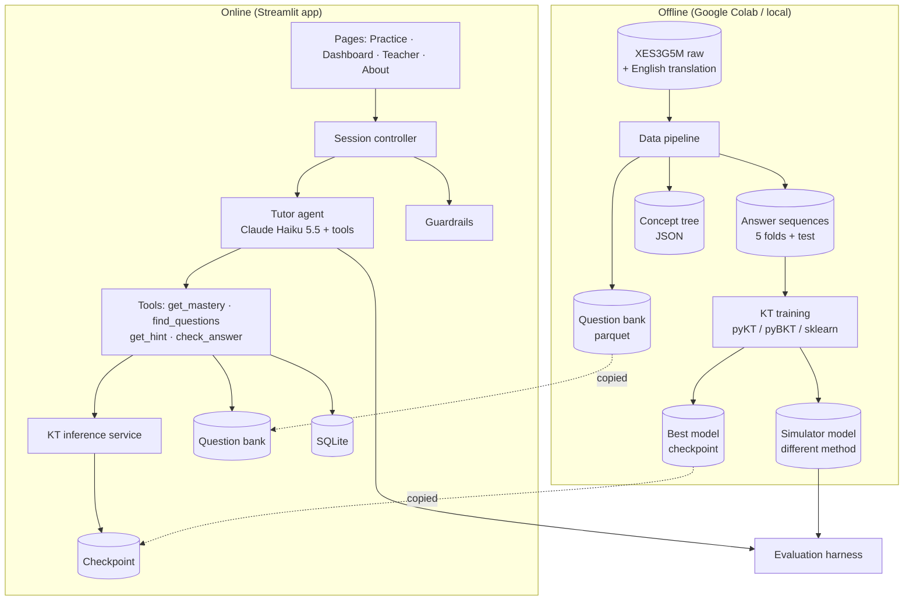

# Technical Requirements Document (TRD)

**Project:** WIH3001: Knowledge-Tracing-Guided LLM Tutor for Primary School Mathematics
**Author:** Tan Wei Ren
**Version:** 0.1 (draft) · **Date:** 27 November 2026
**Related:** [PRD](PRD.md) · [Design](Design.md) · [UI/UX Survey](UX_Survey.md)

This document says *how* the system will be built to meet the PRD. Requirement IDs (F*, N*) refer to the PRD.

---

## 1. System overview



**Key principle:** code decides anything that must be correct or safe:
- marking,
- hint gating,
- what the LLM is allowed to see, and
- the exact question within a difficulty band.

The LLM decides what to do next (which tool, which concept, how hard) and how to say it.

## 2. Technology stack

| Layer | Choice | Notes |
|---|---|---|
| Language | Python 3.11 | Matches pyKT and Colab |
| Data | pandas, pyarrow | Parquet for processed data |
| KT models | pyKT (DKT, SAKT, AKT), pyBKT (BKT), scikit-learn (LR) | PyTorch backend for deep models |
| Concept tree | NetworkX | Prerequisite and order queries |
| LLM | Anthropic API, model `claude-haiku-5-5` | Tool use, streaming, prompt caching |
| Agent loop | Plain Python (LangGraph optional) | A small loop is easier to test and explain |
| App | Streamlit ≥ 1.67 | `st.navigation`, `st.fragment`, `st.chat_message`, `st.write_stream` |
| Charts | Plotly | Dashboard and teacher grid |
| Storage | SQLite (via `sqlite3`) | See §10 for persistence on free hosting |
| Tests | pytest | Unit, integration and red-team suites |
| Hosting | Streamlit Community Cloud | Free; secrets in app settings |

All versions are pinned in `requirements.txt` when implementation starts. Deep models use the CPU-only PyTorch build in deployment to keep the install small.

## 3. Repository and module layout

```
src/tutor/
  config.py              settings (paths, thresholds, model IDs), read from env / st.secrets
  data/
    load.py              read raw XES3G5M + translation
    clean.py             padding removal, joins, image flags, translation checks
    bank.py              build question_bank.parquet and concept_tree.json
  kt/
    train_*.py           one script per model family (run on Colab)
    infer.py             KTService: predict(), mastery()
    bkt_fallback.py      light fallback model
  agent/
    tools.py             the 4 tools (pure functions + JSON schemas)
    policy.py            concept targeting and difficulty band logic
    prompts.py           system prompt and message templates
    loop.py              agent turn: LLM ↔ tools, caps, streaming
    guard.py             answer-leak detection, gating, off-topic handling
    answers.py           answer normalisation and comparison
  app/
    main.py              st.navigation entry point
    pages/practice.py, dashboard.py, teacher.py, about.py
    components/          question card, hint ladder, why panel, mastery bars
  db/
    schema.sql, repo.py
  eval/
    simulator.py, strategies.py, run_sim.py, leak_test.py, hint_sample.py, metrics.py
tests/
```

## 4. Data pipeline (Objective 1; proposal §4.1–4.3)

### 4.1 Inputs
- XES3G5M **question-level** sequence files (5 train/valid folds + test set of 3,613 sequences; up to 200 answers per sequence, padded).
- XES3G5M question metadata: text, answer, worked solution, type, concept routes.
- English translation from KCQRL (Ozyurt et al., 2024).

### 4.2 Steps (proposal §4.2)
1. Load all folds and the test set. Assert that no student appears in both train/valid and test.
2. Remove padding values (`-1`) from sequences.
3. Join English text, answer and solution to each question ID. Keep the Chinese text for reference.
4. Missing or empty translations: mark `has_en = False` and exclude those questions from the tutor bank. They stay in KT training.
5. Flag image-dependent questions. Use markers in the text (image tags or placeholders) plus phrases such as "as shown in the figure", then check by hand. Excluded from the bank; kept for KT training.
6. Split each concept route into levels and build the concept tree (NetworkX DiGraph). The concept order comes from the route order plus the order in which students first meet each concept in the training data.
7. Hand-check 50 random translated questions with a 3-point clarity score and save the results.
8. Split worked solutions into steps (sentence or line splits, then manual spot check). Mark the step(s) that state the final answer (`is_final_step`).

### 4.3 Outputs (dated, e.g. `data/processed/2026-12-01/`)

| File | Content |
|---|---|
| `question_bank.parquet` | `qid, text_en, type (mc/fill), options, answer_raw, answer_norm, steps[], final_step_idx, concepts[], concept_route, difficulty (train correct rate), has_image, has_en, in_bank` |
| `concept_tree.json` | nodes (id, name_en, level, parent), order index, top-level group |
| `sequences_{fold}.parquet` | pyKT format, padding removed for EDA; pyKT's own format kept for training |
| `translation_check.csv` | 50-question hand check |
| `README.md` | Source versions, date, row counts, hash of inputs |

Raw and processed data are **git-ignored** (dataset size; proposal §4.2).

## 5. Learner model (Objective 2; proposal §4.4)

### 5.1 Training
- Models: LR (per-concept counts), BKT (pyBKT), DKT, SAKT, AKT (pyKT).
- pyKT's standard XES3G5M setup with the 5 provided folds. Hyperparameters are tuned on a student sample (Colab GPU). Final scores are on the held-out test set.
- Metrics: **AUC** (main), accuracy, RMSE. Results are compared with Liu et al. (2023) and the KCQRL repository (AKT 81.67%, DKT 78.33% AUC).
- Seeds are fixed, and each run's config and metrics are saved to `runs/` (git-ignored) plus a summary CSV committed to `results/`.

### 5.2 Inference interface

```python
class KTService:
    def predict(self, history: list[Attempt], qids: list[int]) -> dict[int, float]:
        """P(correct) for each candidate question, given the learner's history."""
    def mastery(self, history: list[Attempt], concepts: list[int] | None = None) -> dict[int, ConceptMastery]:
        """Per-concept mastery estimate, with n_answers for uncertainty display."""
```

### 5.3 Mastery definition
- For deep models and LR: **mastery(c)** is the mean predicted P(correct) over a fixed probe set of up to 10 bank questions tagged with concept *c*. Probe sets are chosen once, spread across difficulty.
- For BKT: mastery(c) = P(L) for concept *c*.
- Bands (tunable, used in the UI and policy):

| Band | Range | UI label |
|---|---|---|
| Not yet | < 0.60 | Not yet |
| Getting there | 0.60–0.85 | Getting there |
| Mastered | ≥ 0.85 | Mastered |

- **Uncertain** if `n_answers(c) < 3`. This is shown as a dashed bar (Design §4.4).

**Cost control:** after each answer, recompute mastery only for the *active set*: concepts already attempted plus the next 20 candidate concepts from the policy (≤ ~60 concepts, ≤ 600 predictions in one batch). The full 865-concept refresh runs at session end. Results are written to `mastery_snapshots`.

### 5.4 Deployment fallback
If the chosen deep model can't load within memory or time limits on the free host, the app uses BKT or LR mastery. `config.KT_BACKEND` selects the model, and the About page shows which model is live.

### 5.5 Cold start (F3)
The diagnostic serves 6–8 questions: one from each of the earliest top-level concept groups, at medium difficulty, with no hints. After the diagnostic, the history is passed to the KT model as normal.

## 6. Tutor agent (Objective 3; proposal §4.5)

### 6.1 Tools

All tools are pure Python functions with JSON schemas. Tool results are **filtered views**: they never contain the final answer unless the question is finished.

| Tool | Input | Returns | Enforced in code |
|---|---|---|---|
| `get_mastery(student_id)` | learner code | per-concept `{mastery, band, n_answers}` for the active set, plus `candidates`: top 5 target concepts with policy score and reason code | — |
| `find_questions(concept, difficulty)` | concept ID; `"easier"`, `"target"` or `"harder"` | **one** question: `{qid, text, type, options, p_correct, reason}` | The specific question is chosen in code: unseen, in bank, not flagged, P(correct) in band (target = [0.60, 0.85], easier = (0.85, 0.95], harder = [0.45, 0.60)), closest to 0.72. No answer or solution is included. |
| `get_hint(question_id, level)` | qid, level 1–3 | L1: concept name + a guiding prompt seed; L2: next unrevealed step; L3: concept summary + full worked solution of a *related* question (same concept, different qid) | Returns `{"locked": true, "unlocks_after_attempts": n}` if not unlocked; never returns `final_step_idx` content before the question is finished |
| `check_answer(question_id, answer)` | qid, raw answer | `{correct, attempt_no, finished, unlocked_levels, worked_solution?}`; `worked_solution` only when `finished` | Marking uses `answers.py`; writes the attempt and updates mastery |

**Note on the UI:** in the app, the answer box and hint buttons call `check_answer` / `get_hint` **directly from code** (instant, can't be skipped). The result is then passed to the agent as an *event* so it can respond. The agent can also call the tools itself during chat (e.g., `get_hint` when the learner types "I'm stuck"). The four tools in proposal Table 5 are therefore unchanged.

### 6.2 Policy (proposal §4.5, "diagnose, plan, teach, assess, reflect")

Target concept score for candidates:

```
eligible(c)  = band(c) != Mastered and all prerequisites of c have mastery >= 0.60
score(c)     = (1 - mastery(c)) * w_weak + (1 - order_rank(c)) * w_early
candidates   = top 5 eligible concepts by score
```

- Weights `w_weak` and `w_early`, and the [0.60, 0.85] band, are tuned in simulation (§9).
- Each candidate carries a `reason_code`: `WEAKEST_EARLY`, `PREREQ_FOR_NEXT`, `REVIEW_SLIPPING` or `LEARNER_CHOICE`. The UI turns the code into one sentence (Design §7.3).
- **The agent may choose any concept among the candidates** (it usually picks the first). This keeps "the agent decides" true without letting it wander. If the learner picks a concept on the dashboard (F19), that concept is used with `LEARNER_CHOICE`.

### 6.3 Agent turn loop

```
on event (session_start | answer_checked | hint_shown | learner_message | question_finished):
    messages = system + tool defs (cached) + session summary + current question context + last 6 turns + event
    loop up to MAX_TOOL_CALLS_PER_TURN (4):
        response = LLM(messages, tools, stream=True, max_tokens=300)
        if response has tool calls: run tools (with gating), append results, continue
        else: stream text through guard → UI; break
    if cap reached: send a fallback message from template
```

- **Streaming:** text is streamed to `st.write_stream` through the guard (§7.3). Tool calls show a status line (Design §4.3).
- **Prompt caching:** the system prompt and tool definitions are a fixed prefix marked for caching. Session-specific content comes after the prefix.
- **Context:** per question, keep the question context and that question's turns. Older questions are compressed into one-line summaries ("Q2 speed: correct on 2nd try, used L2 hint").
- **Reply limit:** the system prompt asks for ≤ 60 words; `max_tokens` = 300 caps the worst case.
- **Errors:** on API error or timeout (8 s), retry once. Then switch to **degraded mode** (N8): templated messages, and hints are the raw step text from `get_hint`.

### 6.4 System prompt outline
1. Role: a friendly maths tutor for 8–9-year-olds; plain English; short sentences.
2. Hard rules:
   - never state or confirm the final answer before `finished` is true;
   - guesses typed in chat go to the answer box ("Pop it in the answer box and I'll check!");
   - explain using tool content only;
   - one idea per message;
   - end with something the learner can do.
3. Loop guidance: when to call which tool; always use `find_questions` with a concept from `candidates`.
4. Style rules from Design §7: no generic praise or mindset slogans; specific feedback.
5. Off-topic and safety: steer back to maths; do not ask for or repeat personal details.

### 6.5 Cost estimate

| Item | Assumption | Cost |
|---|---|---|
| Price (Haiku 5.5, per 1M tokens) | input $0.10, cached input $0.01, output $0.50 | — |
| One turn | ~2.5K cached + ~1K uncached input, ~150 output, ~1.5 LLM calls | ≈ USD 0.0003 |
| User study | 30 volunteers × 40 turns | ≈ USD 0.40 |
| Simulation (§9) | 200 students × 20 questions × ~2 turns | ≈ USD 2.40 |

The total is well under the N2 cap. Prompts over 100K tokens cost more, but this design never comes close.

## 7. Guardrails (C5: answer withholding cannot be switched off)

Four layers, so that no single failure leaks the answer:

| Layer | Mechanism |
|---|---|
| 1. Information hiding | Before `finished`, the LLM never receives `answer_raw`, `answer_norm` or the final step |
| 2. Tool gating | `get_hint` checks attempt count server-side; locked levels return `locked` |
| 3. Instructions | System prompt hard rules (§6.4) |
| 4. Output check | `guard.py` checks every outgoing message (below) |

### 7.1 Output check
- Before `finished`, compute the answer's surface forms:
  - the normalised number,
  - common variants ("60", "60.0", "sixty", "60 km/h"), and
  - for multiple choice, the option letter and option text.
- The LLM can still *compute* the answer itself (e.g., 120 ÷ 2), so layer 1 alone is not enough.
- **Streaming check:** text is released with a 12-character holdback buffer. If a surface form appears, the stream is cut. The message is replaced by a safe template, and the event is logged as `leak_blocked`.

### 7.2 Answer normalisation (`answers.py`)
- Strip spaces and units.
- Accept `1/2`, `0.5` and `½` as equal.
- Use numeric tolerance 1e-6.
- Multiple choice is compared by option key.
- Fill-in answers with more than one blank are split on the dataset's separator.
- Every rule has unit tests built from real bank examples.

### 7.3 Red-team set
A file `tests/redteam_prompts.yaml` holds 50+ prompts, including:
- direct asks,
- authority claims ("my teacher said…"),
- role-play,
- "just confirm is it 60?",
- multi-turn pressure, and
- prompt injection inside a free-text answer.

`eval/leak_test.py` runs these against (a) the agent and (b) a plain LLM with no tools or rules, and reports the leak rate (F10, F28).

## 8. Data storage (SQLite)

### 8.1 Schema

```sql
learners(learner_code TEXT PRIMARY KEY, class_code TEXT, created_at, consent_at, is_demo INTEGER)
sessions(session_id INTEGER PRIMARY KEY, learner_code, started_at, ended_at, kind TEXT)  -- diagnostic|practice
recommendations(rec_id INTEGER PRIMARY KEY, session_id, qid, concept_id, mastery_before REAL,
                p_correct REAL, reason_code TEXT, chosen_by TEXT, created_at)          -- agent|learner
attempts(attempt_id INTEGER PRIMARY KEY, session_id, rec_id, qid, answer_raw TEXT, correct INTEGER,
         attempt_no INTEGER, ms_since_shown INTEGER, created_at)
hint_events(hint_id INTEGER PRIMARY KEY, session_id, qid, level INTEGER, source TEXT,  -- button|agent
            before_first_attempt INTEGER, ms_since_shown INTEGER, ms_to_next_action INTEGER, created_at)
messages(msg_id INTEGER PRIMARY KEY, session_id, role TEXT, content TEXT, tool_calls_json TEXT,
         input_tokens INTEGER, output_tokens INTEGER, cache_read_tokens INTEGER, latency_ms INTEGER,
         guard_event TEXT, created_at)
mastery_snapshots(learner_code, concept_id, mastery REAL, n_answers INTEGER, model TEXT, taken_at)
question_reports(report_id INTEGER PRIMARY KEY, learner_code, qid, reason TEXT, comment TEXT, created_at)
teachers(class_code TEXT PRIMARY KEY, passcode_hash TEXT, created_at)
teacher_views(class_code, learner_code, viewed_at)
```

- Learner free-text chat is stored for evaluation, but the consent screen says so. Chat text is excluded from the CSV export.
- `before_first_attempt` and `ms_to_next_action` implement the premature-hint and superficial-reading indicators (UX Survey D3).

### 8.2 Learner codes
- Codes are generated as `ADJECTIVE-ANIMAL-NN` (e.g., `BRAVE-OTTER-27`): easy for children and not linked to any identity.
- Teacher passcodes are stored as salted hashes. The master teacher passcode for the study lives in `st.secrets`.

### 8.3 Teacher flags (F23)
| Flag | Rule (tunable) |
|---|---|
| Stuck | ≥ 3 wrong attempts on the same concept in the last 10 attempts |
| Hints before trying | ≥ 40% of the last 10 questions had a hint before the first attempt |
| Inactive | No attempt in 7 days (class mode) or 5 minutes during a live session |

## 9. Evaluation harness (Objective 4; proposal §4.6)

| Part | Implementation |
|---|---|
| Simulated students | Sampled from test-set histories (warm start: first 20 answers). Answers are drawn from `Bernoulli(p)`, where `p` comes from a **separate simulator model** trained with a different method (e.g., if AKT drives the tutor, DKT with a different seed and split drives the simulator), so the tutor is not graded by its own model |
| Strategies | Agent (LLM + tools), random, fixed concept-tree order, lowest-mastery rule |
| Budget | Same N questions per strategy (N = 20), same students (n = 200), 3 seeds |
| Measures | Simulated mastery gain on targeted concepts (simulator's view); share of questions on unmastered concepts; mean P(correct) of served questions (is it in the 60–85% band?) |
| Leak test | §7.3: agent vs plain LLM |
| Hint quality | `hint_sample.py` exports 100 random hints with their source step for 2 raters (rubric: correct, grounded, no answer given, addresses the error); Cohen's kappa |
| Usability | SUS (Brooke, 1996) from adult volunteers, plus the "why this question" comprehension item |

- The agent strategy runs the real LLM loop with a **simulated learner adapter** that answers via the simulator and never chats.
- Agent hint requests are simulated with a fixed rule (request L1 after a wrong attempt). This removes UI effects so the comparison is about question choice.
- The limitation "simulated gain is not real learning" is stated with the results.

## 10. Deployment

| Item | Plan |
|---|---|
| Host | Streamlit Community Cloud, linked to this GitHub repo |
| Secrets | `ANTHROPIC_API_KEY`, `TEACHER_MASTER_PASSCODE`, optional `FALLBACK_MODEL_URL` in app settings; locally in `.streamlit/secrets.toml` (git-ignored) |
| Artefacts | `question_bank.parquet`, `concept_tree.json` and the KT checkpoint are kept small. If the files can't be committed (size or licence), they are downloaded at start-up from a GitHub Release asset |
| Persistence | Community Cloud's local disk should **not be assumed persistent** across restarts. For the user study, either: (a) export the database after each session block to the researcher, (b) use a free hosted SQLite-compatible or Postgres service, or (c) run the study locally. Decide before P6 |
| Start-up | KT model and bank loaded once with `st.cache_resource`; target cold start < 60 s |
| Fallback LLM | Small open-weight model behind the same agent interface (proposal §3.2); used only in degraded mode |

## 11. Observability

- Per LLM call, record tokens (input, cached, output), latency, tool calls and guard events in `messages`.
- A hidden `?debug=1` panel (examiner view, PRD user story 16) shows the last tool calls and raw values.
- A daily cost summary is computed from token counts.

## 12. Testing

| Suite | What | When |
|---|---|---|
| Unit | Answer normalisation, hint gating, policy scoring, band mapping, flag rules | Every commit |
| Tool contract | Tool outputs never contain answer fields before `finished` (property-based over the bank) | Every commit |
| Agent integration | Agent loop with a mocked LLM (scripted tool calls) | Every commit |
| Red-team | §7.3 against the live model | Before each deploy; results saved |
| Simulation smoke | 5 students × 5 questions | Before long runs |
| Accessibility | Contrast tokens checked by script; keyboard-only run-through; screen-reader labels on custom components | Before the user study |
| Load | 5 concurrent sessions on the deployed app | Before the user study |

## 13. Security and privacy

- No personal data is collected. The learner code is the only identifier.
- Volunteers give consent before the study (timestamp stored).
- The API key exists only in secrets; it is never sent to the browser or logged.
- Prompt injection through answers or chat is handled because tool permissions don't depend on LLM output: gating and marking are code. Injection prompts are covered by the red-team set.
- Data is kept until the project is assessed, then deleted. Only aggregated results go into the report.

## 14. Open technical questions

1. Can the chosen deep KT model run on CPU within the free host's memory? Measure in P2. Otherwise use the BKT or LR fallback (§5.4).
2. Step splitting quality for worked solutions: do rule-based splits work, or is a one-time LLM pre-pass (reviewed by hand) needed?
3. Persistence option for the user study (§10).
4. Choice of fallback open-weight model and where to run it for free.
